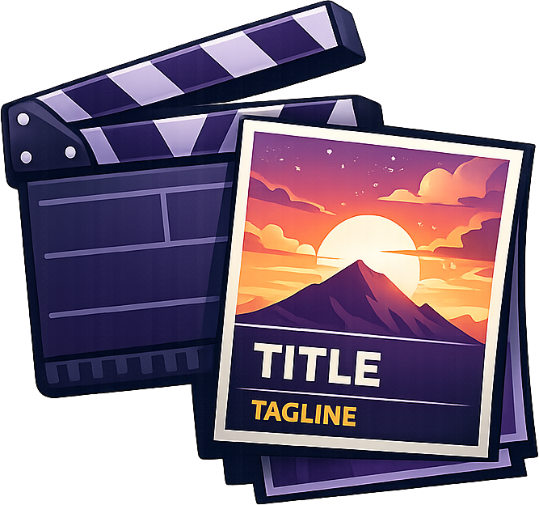
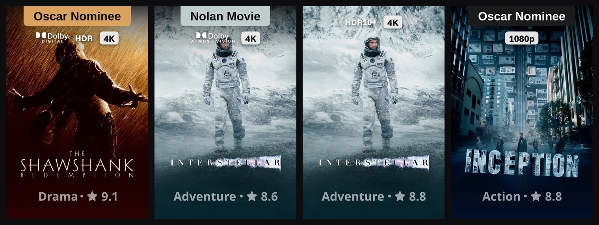

<div align="center">



# Better Posters (Local Quality Fix)

[](https://github.com/ushereats/better-posters-quality-fix/releases/latest)
[](https://github.com/ushereats/better-posters-quality-fix/actions/workflows/build.yml)
[](https://jellyfin.org)
[](./LICENSE.md)
[](https://github.com/ushereats/better-posters-quality-fix)
[](https://github.com/ushereats/better-posters-quality-fix)

**Better Posters (Local Quality Fix)** is an unofficial Jellyfin plugin that replaces your movie and show posters with [btttr.cc](https://btttr.cc) posters, with quality badges read from **your own files**.



</div>

**Minimum Jellyfin version:** 12.0

A fork of [Better Posters](https://github.com/neurekadev/better-posters). The original takes its 4K / HDR badges from btttr.cc's database, so they often don't match the file you actually have. This version reads the quality from Jellyfin's own scan of the file (the same data as **Media Info**) and draws the badges onto the poster itself, so they show in every Jellyfin app: web, Android TV, phones, Infuse and others.

## Features

- **Studio Posters:** Each title's clean artwork (no text on it) from TMDb with its logo over a soft fade, an info line (rating, year, genre) and the quality badges. Or keep btttr.cc's ready-made posters: one setting.
- **Real Quality Badges:** **4K**, **1440p**, **1080p**, **720p** and **SD**, read from the video file Jellyfin scanned.
- **HDR Detection:** **HDR**, **HDR10+** and **HLG**.
- **Dolby:** Dolby logo with **ATMOS** and/or **VISION** underneath for Dolby Atmos and Dolby Vision, and **DIGITAL** for Dolby Digital / Digital Plus / TrueHD.
- **Shows:** Uses the best quality among the show's newest episodes.
- **Ushereats Theme Look:** Badges in the same style as the [Ushereats Theme](https://github.com/ushereats/ushereats-modern-theme), centred at the top with a soft shadow. When a trend tag ("Oscar Nominee", "Emmy Winner"...) is on the poster, the badges sit just under it.
- **Automatic:** New and upgraded titles get their poster a few seconds after Jellyfin has their details. A nightly task catches everything else and only re-downloads titles whose poster or quality changed.
- **Every Library:** Covers all movie and show libraries by default. No per-library image fetcher setup needed.
- **Poster Options:** Trend tags, genre, ratings (average, IMDb, TMDB, Rotten Tomatoes, Metacritic, Trakt, Letterboxd or Roger Ebert) and age rating.
- **Multi-Language Posters:** English, Spanish, French, German, Portuguese, Italian, Dutch, Polish, Russian, Turkish, Arabic, Japanese, Korean, Chinese, Hindi, Swedish or Czech.

## Installation Guide

### Option 1: Install from the Plugin Repository

1. Open **Dashboard -> Plugins -> Repositories** in Jellyfin.
2. Add this repository URL:

    ```text
    https://raw.githubusercontent.com/ushereats/better-posters-quality-fix/main/manifest.json
    ```

3. Open **Dashboard -> Plugins -> Catalog**.
4. Select **Better Posters (Local Quality Fix)** and install the latest version.
5. Restart Jellyfin.
6. Confirm **Better Posters (Local Quality Fix)** appears under **Dashboard -> Plugins -> My Plugins**.

If you have the original **Better Posters** plugin installed, uninstall it so the two don't fight over the same posters.

### Option 2: Install Manually from a Release

1. Download the latest `better-posters-quality-fix_*.zip` from the [GitHub releases page](https://github.com/ushereats/better-posters-quality-fix/releases/latest).
2. Stop Jellyfin.
3. Create a `BetterPostersQualityFix` folder under your Jellyfin plugins directory.
4. Extract the release zip into that folder (`BetterPosters.dll` plus the `SixLabors.*.dll` files).
5. Start Jellyfin.
6. Confirm **Better Posters (Local Quality Fix)** appears under **Dashboard -> Plugins -> My Plugins**.

### Option 3: Build from Source

1. Install the .NET 10 SDK.
2. From this repository, run:

    ```shell
    dotnet publish BetterPosters/BetterPosters.csproj -c Release -o out
    ```

3. Stop Jellyfin.
4. Create a `BetterPostersQualityFix` folder under your Jellyfin plugins directory.
5. Copy `BetterPosters.dll` and the `SixLabors.*.dll` files from `out` into that folder.
6. Start Jellyfin.
7. Confirm **Better Posters (Local Quality Fix)** appears under **Dashboard -> Plugins -> My Plugins**.

## Configuration & Setup

Open **Dashboard -> Plugins -> My Plugins -> Better Posters (Local Quality Fix)**.

Default settings:

- **Trend Tags:** Enabled
- **Quality Badges:** Enabled
- **Genre:** Enabled
- **Ratings:** Enabled
- **Ratings Source:** Average
- **Age Rating:** Disabled
- **Language:** English
- **All Movie and Show Libraries:** Enabled
- **New Titles Straight Away:** Enabled

The **Update Better Posters (Local Quality Fix)** task runs every night at 4 AM. Change it under **Dashboard -> Scheduled Tasks** if you want a different time.

## How to Apply Posters to Your Library

### Option A: Do Nothing

After installing, posters are applied on their own: new titles a few seconds after Jellyfin has their details, everything else on the next nightly run.

### Option B: Apply Now

1. Open **Dashboard -> Plugins -> My Plugins -> Better Posters (Local Quality Fix)**.
2. Select **Update posters now** to update every title that's missing its poster or whose quality changed.
3. Or select **Replace every poster now** to download and redraw every poster, for example after changing settings.

### Option C: Apply to a Single Movie or Show

1. Open a movie or show in Jellyfin.
2. Select **Edit Images**.
3. Search remote images.
4. Choose the **Better Posters (Local Quality Fix)** primary image.

## Troubleshooting

- **No poster appears:** Confirm the title has an IMDb ID (normal Jellyfin metadata provides it). btttr.cc posters are looked up by IMDb ID.
- **Badges are missing or wrong:** The badges come from Jellyfin's scan of the file. Check the title's **Media Info**. If the file was replaced, refresh the title's metadata, then select **Update posters now**.
- **Only the old 1.0.x version installs:** Remove the repository under **Dashboard -> Plugins -> Repositories**, add the URL above again, then install from the catalog.
- **Poster did not change:** Clear the browser cache or check another Jellyfin app. Jellyfin and browsers cache images aggressively.
- **Badges show twice in the web app:** The Ushereats Theme has its own **Quality badges** option that draws the same badges over posters. Turn one of them off.

## Disclaimer

This is an unofficial Jellyfin plugin, forked from [neurekadev/better-posters](https://github.com/neurekadev/better-posters). Poster artwork is provided by [btttr.cc](https://btttr.cc). Badges use the Funnel Sans font (SIL Open Font License). Dolby, Dolby Vision and Dolby Atmos are trademarks of Dolby Laboratories.
